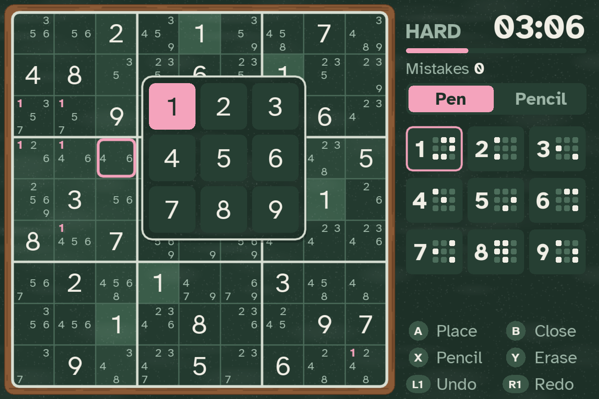
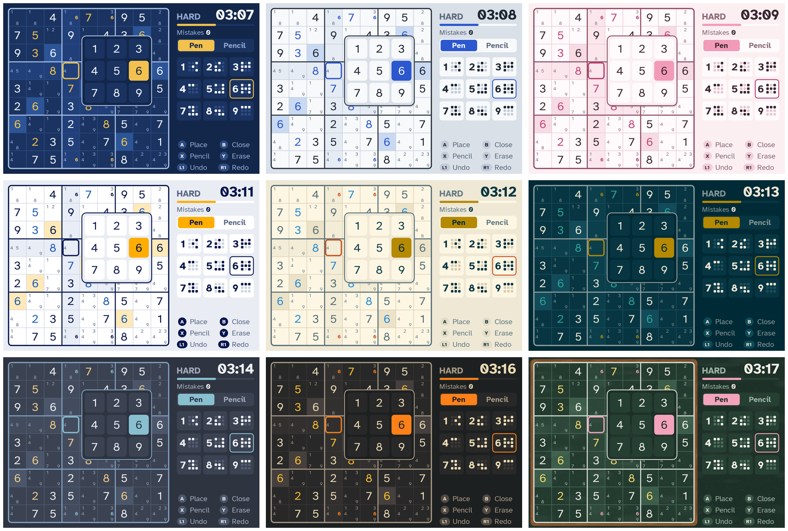
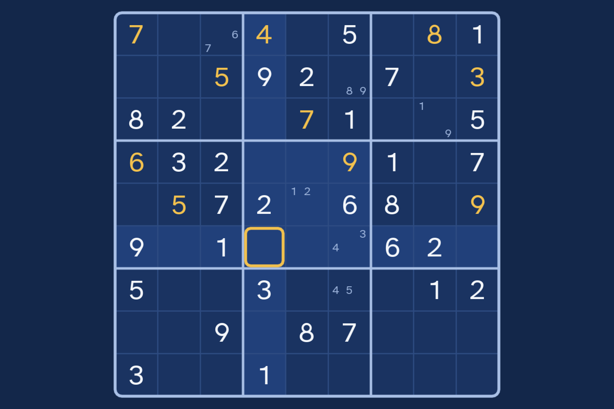

# muSudoku

A Sudoku game for muOS (MustardOS) handhelds, built with LÖVE 11.5. Designed for
the Anbernic RG34XXSP's 720×480 screen and scaled to fit other resolutions.

 
 

## Features

- Four difficulties. Puzzles are generated on the device, always have exactly one
  solution, and are graded by the techniques a person needs to solve them. Two
  generators to choose from in Settings: Classic and Dancing Links (see "How puzzles
  are made" below):
  - **Easy**: scanning rows and boxes (hidden singles)
  - **Medium**: adds cells with only one possible number (naked singles)
  - **Hard**: needs pointing pairs, or naked and hidden pairs and triples
  - **Expert**: needs techniques beyond those
- Pen and pencil modes, one-button note filling, and notes that clear themselves
- Undo and redo, optional mistake checking
- Optional explained hints (off by default): Y finds the easiest logical move and
  explains it on the board, walking through any groundwork it needs first (see
  "Explained hints" below)
- Highlights for the cursor's row, column and box, and for matching numbers
- Distraction-free mode, from the pause menu: just the board, centered on the screen
- Celebrations: completing a row, column, box or all nine of a number makes the
  digits bounce in a ripple with a glow pulse, and solving the puzzle adds a
  board-wide wave and confetti
- Auto-save, with Continue on the title screen
- Statistics per difficulty: started, solved, best and average time
- Nine themes. Light: Paper, Sakura, Frankfurt (Lufthansa blue and yellow) and
  Solarized Light. Dark: Cyanotype (default), Solarized Dark, Nord, Gruvbox, and
  Chalkboard (green slate with chalk dust and a wooden frame around the board)
- Sound effects generated in code, so no audio files are needed
- Puzzle packs: play collections of puzzles published by others, with progress
  tracked per pack
- Battery friendly: the screen is only redrawn when something changes, and with
  sound effects off the audio system isn't started at all (see "Idle rendering"
  below)



## Install on the device

1. Run `./build.sh`, or use a prebuilt `muSudoku_vX.Y.Z.muxapp`.
2. Copy the `.muxapp` to `/mnt/mmc/MUOS/ARCHIVE/` on the SD card.
3. On the device, open **Applications → Archive Manager** and install it.
4. Launch **muSudoku** from Applications.

Saves are stored in `MUOS/application/muSudoku/.game/save/` and puzzle packs in
`MUOS/application/muSudoku/packs/`. Installing an update over the app should keep both,
since the package doesn't contain those files, but back them up before reinstalling.
If the game doesn't start, check `MUOS/application/muSudoku/.game/musudoku.log`.

## Puzzle packs

Puzzle packs are text files of puzzles you add yourself. Put them in:

```
MUOS/application/muSudoku/packs/
```

That's the folder next to `mux_launch.sh` on whichever SD card the app is installed
on. It's created on first launch, and the game shows the exact path if it's empty.
Open **Puzzle packs** from the title screen, pick a file, then play the next unsolved
puzzle, a random one, or a puzzle by number.

**Formats.** Files ending in `.txt`, `.sdm`, `.sdk`, `.csv` or `.ss` are read. Each
puzzle is either one line of 81 characters (1–9 for givens, 0 or . for empty cells)
or a grid of 9 lines with 9 cells each. Divider lines, `|`, header lines like
`Grid 01`, `#` comments and extra columns (ids, ratings, CSV fields, a solution after
the puzzle) are ignored. Up to 100,000 puzzles per file are used, so split bigger
collections into several files.

**Checking and grading.** When you start a puzzle the game checks it has exactly one
solution, skipping it with a message if not, and grades it Easy to Expert with the
same rules as generated puzzles. Pack puzzles don't count toward Statistics. Progress
is saved per file name, and changing a file's contents resets its progress.

**Where to find puzzles.** The Sudoku Exchange puzzle bank
(github.com/grantm/sudoku-exchange-puzzle-bank) says its puzzles are free to use for
any purpose. Other well-known collections, such as Gordon Royle's 17-clue list, the
Enjoy Sudoku forum's hardest puzzles and Kaggle datasets, have their own terms or none
stated, so check before sharing them further.

The muxapp ships `Starter pack.txt`: 40 puzzles from this game's own generator, free
to use.

## Controls

| Button | On the board | In the number pad |
|---|---|---|
| D-pad | Move (hold to repeat, wraps at edges) | Choose a number |
| A | Open the number pad | Place number, or toggle note in pencil mode |
| B | Erase the cell | Close |
| X | Switch pen / pencil | Switch pen / pencil |
| Y | Hint, if turned on in Settings | Erase the cell |
| L1 / R1 | Undo / redo | Undo / redo |
| Select | Fill all notes, or clear them if there are any | |
| Start / Menu | Pause menu | Pause menu |

### Explained hints

Hints are off by default. Turn them on in **Settings → Hints**, which has three
choices: **Off** hides the hint button and the hint counter, **Explained** gives the
hints described here, and **Instant** reveals a number straight away.

With Explained hints on, press Y and the side panel explains the easiest move a
person could make right now, with the board highlighting the cells involved:

- **Only place for a number:** a number that fits just one cell in a row, column or
  box. The numbers blocking the other cells are circled.
- **Only number that fits:** a cell where every other number is already in its row,
  column or box.
- **Last empty cell** in a row, column or box.
- **Groundwork steps** for harder puzzles: pointing pairs, numbers locked in a box,
  naked pairs and triples, and hidden pairs. Ruled-out candidates are struck through
  in red, and A removes them from your notes. Only steps the final move depends on
  are shown.
- **Mistakes come first:** if a number on the board is wrong, the hint points it out
  and A erases it.
- **Fallback:** for moves beyond these techniques (some Expert puzzles), it says so and
  offers the number.

In the hint: A does the step's action, Y goes to the next step, L1 goes back, B
closes. Opening a hint counts as one hint. Hints work from the numbers on the board, not your notes, so
they're right even when your notes are incomplete.

In pen mode the pad closes after placing a number. In pencil mode it stays open so
you can toggle several notes. Hints reveal the selected cell, or the easiest unsolved
cell if the selected one is already right. Hinted cells lock, and solves with hints
don't count toward best times.

On a PC keyboard: arrows move, Enter/Space is A, Backspace is B, X and Y are X and Y,
Q/E are L1/R1, Tab is Select, Esc is Start, and 1–9 / 0 enter or erase directly.

### Distraction-free mode

Choose **Distraction-free** in the pause menu to hide the side panel and center the
board, with nothing else on screen. **Show side panel** in the same menu brings it
back, and the choice is remembered. The clock keeps running and shows in the pause
menu, and an explained hint brings the panel back until you close it.



## How puzzles are made

Every puzzle has only one solution, so each number can be worked out and there's
never a point where two different answers would both be right.

1. The game fills a complete 9×9 grid at random. That grid is the answer.
2. It removes clues in mirror-image pairs, which keeps the puzzle symmetric. After
   each pair, the solver checks whether the puzzle could now be completed in any way
   other than the answer. If it could, the pair goes back. So no clue is ever removed
   unless the answer stays the only solution.
3. The puzzle is graded by the techniques it needs (see Features). If it's too easy
   for the chosen difficulty, more clues come out, each pair checked the same way.
   Each difficulty gets several tries, and if none matches exactly, the closest one
   is used. It too has only one solution.

**Two generators.** Settings → Puzzle generator picks the solver used in steps 1 and
2. Both follow the steps above, so the puzzles are equally unique and graded the same
way:

- **Classic** (default): a backtracking solver that fills the most constrained cell
  first.
- **Dancing Links**: Donald Knuth's Algorithm X with dancing links. Sudoku becomes an
  exact cover problem: 729 choices (a digit in a cell) and 324 rules that must each be
  met exactly once (every cell filled, every digit once per row, column and box). It
  takes a little longer than Classic.

Pack puzzles weren't made by this generator, so the game checks each one for a single
solution when you start it (see "Puzzle packs"). `./build.sh test` generates puzzles at
every difficulty with both generators and checks that each has exactly one solution,
using the other solver to confirm Dancing Links puzzles.

## Development

Requirements: LÖVE 11.5 and LuaJIT for running on a PC, plus `bash`, `git` and `zip`
for building.

```sh
./build.sh run            # play on a PC (720x480 window)
./build.sh run 640x480    # try another resolution
./build.sh test           # engine, puzzle pack and hint tests (luajit)
./build.sh love           # build/muSudoku.love
./build.sh                # build/muSudoku_vX.Y.Z.muxapp
./build.sh portmaster     # build/portmaster/musudoku/ and build/musudoku.zip
```

### On macOS

1. Download LÖVE 11.5 for macOS from https://love2d.org and drag `love.app` into
   Applications. If macOS blocks it the first time, right-click it and choose Open.
2. In Terminal, from this folder: `./build.sh run` (it finds `love.app` itself). Puzzle
   packs are read from the project's `packs/` folder.
3. Optional: `brew install luajit` for `./build.sh test`.

Saves go to `~/Library/Application Support/LOVE/musudoku/`. Delete that folder to
start fresh. `./build.sh` also builds the `.muxapp` on a Mac (needs `git`, which comes
with the Xcode command line tools).

### Screenshot harness

`MUSUDOKU_AUTOSHOT=1 love game` plays through every screen automatically and saves
screenshots to the LÖVE save folder (`~/.local/share/love/musudoku/shots/` on
Linux). Use it to check layout changes. With no display, prefix it with
`xvfb-run -a` and set `SDL_AUDIODRIVER=dummy`.

### Idle rendering

`main.lua` replaces LÖVE's default loop, which redraws 60 times a second, with one
that draws only when needed:

- after any button press, plus 0.1 s to be safe
- while the top screen's `busy()` returns true (cursor sliding, the pad and menus
  opening, flashes, the win wave, puzzle generation, reading a pack)
- when a screen calls `app.requestRedraw()`, which the timer does once a second

In between it sleeps, checking for input 60 times a second, or 30 once nothing has
been pressed for 2 seconds. Analog-stick drift doesn't wake it. Every animation
relies on `busy()`: when adding one, make the screen's `busy()` return true while it
runs, or it will freeze mid-way.

The audio mixer runs all the time once started, even when silent, so `conf.lua`
reads the saved settings first and leaves the audio modules out when sound effects
are off. Turning sound on later loads them then.

`MUSUDOKU_FXSHOTS=1 love game` captures the completion effects mid-animation.

`MUSUDOKU_IDLETEST=1 love game` measures it. On a PC, a puzzle left alone for 10 seconds
drew 10 frames (one per timer tick) instead of about 600, and none with the timer
hidden. A button press draws about 7 frames.

### Project layout

```
mux_launch.sh        muOS launcher (sets up SDL, saves, runs LÖVE)
mux_lang.ini         Name and help text shown in the muOS menu
glyph/               Menu icon
portmaster/          PortMaster launcher, port.json, gameinfo.xml, README and
                     screenshot
screenshots/         Images used in this README (not packaged)
build.sh             Build, test and run commands
packs/               Starter pack (copied into the muxapp)
tests/               Engine and pack-format tests (plain luajit, no LÖVE needed)
game/                The LÖVE game (becomes .game/ in the muxapp)
  main.lua           Scene stack, saving, resolution handling
  src/sudoku.lua     Solver, generator and difficulty grader
  src/dlx.lua        Dancing Links (Algorithm X) solver, the other generator option
  src/game.lua       Puzzle state, notes, undo/redo, hints, serialization
  src/storage.lua    Settings, statistics and save files
  src/packs.lua      Puzzle pack folder, file formats, indexing, progress
  src/hints.lua      Explained hints: finds moves and writes explanations
  src/ui.lua         720x480 layout scaling, text and button glyphs
  src/input.lua      Gamepad and keyboard mapping, hold-to-repeat
  src/theme.lua      Color themes, chalk dust texture and wooden frame
  src/sound.lua      Synthesized sound effects
  src/scenes/        Title, difficulty, generating, play, pause, win,
                     settings, statistics, confirm, packs, pack and about
                     screens
  dev/autoshot.lua   Screenshot harness (left out of builds)
  dev/idletest.lua   Measures frames drawn while idle (left out of builds)
  dev/fxshots.lua    Screenshots of the completion effects (left out of builds)
  dev/hintshots.lua  Screenshots of explained hints (left out of builds)
```

### The LÖVE runtime

muOS doesn't include LÖVE, so the muxapp bundles an aarch64 build of LÖVE 11.5
(`bin/love` and `bin/libs.aarch64/`). `build.sh` downloads a prebuilt runtime by
saitamasahil (MIT licensed) at a pinned tag, because it's known to work on muOS H700
devices. To use a different
runtime, set `LOVE_RUNTIME=/path/to/dir` containing `love` and `libs.aarch64/`.
That bundle includes libraries the game doesn't need, so a trimmed runtime would
make the package much smaller.

## Credits and licenses

muSudoku was created by amiralul. **About** on the title screen shows these credits
in the game.

- Game code: MIT (see `LICENSE`)
- Atkinson Hyperlegible font by the Braille Institute: SIL Open Font License
- LÖVE: zlib license
- aarch64 LÖVE runtime and launcher structure: saitamasahil (MIT)
- Dancing Links generator: Donald Knuth's Algorithm X
- Theme colors: Solarized by Ethan Schoonover, Nord by Arctic Ice Studio and Gruvbox
  by Pavel Pertsev (all MIT)
