# muSudoku

Four logic puzzles for handhelds, built with LÖVE 11.5: **Sudoku**, **Solo**,
**Pairlink** and **Hoshi**. The title screen shows a box for each; pick one with L1 / R1,
or press left and move between the boxes with the D-pad. It runs on
MustardOS, and on other handheld systems through PortMaster. Designed for the Anbernic
RG34XXSP's 720×480 screen and scaled to fit other resolutions.

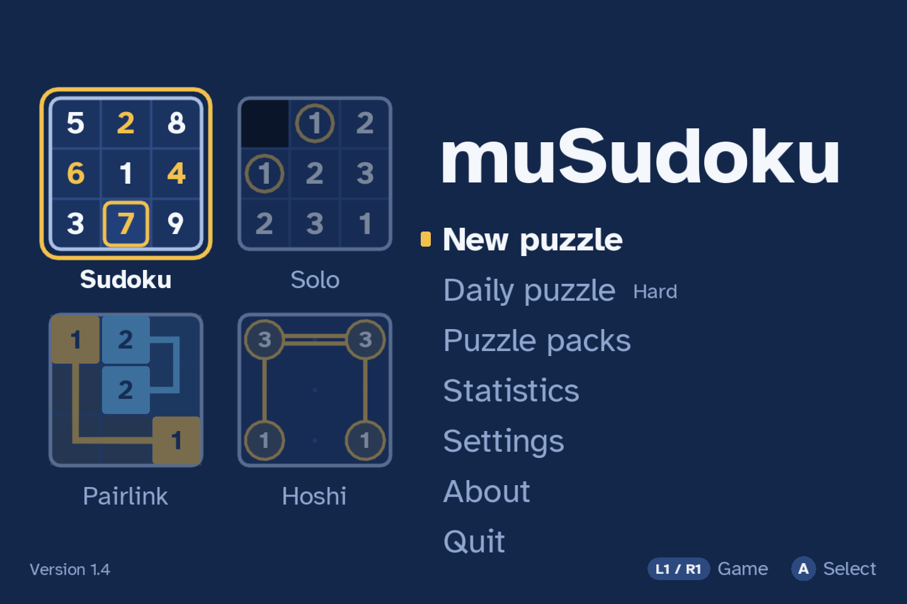 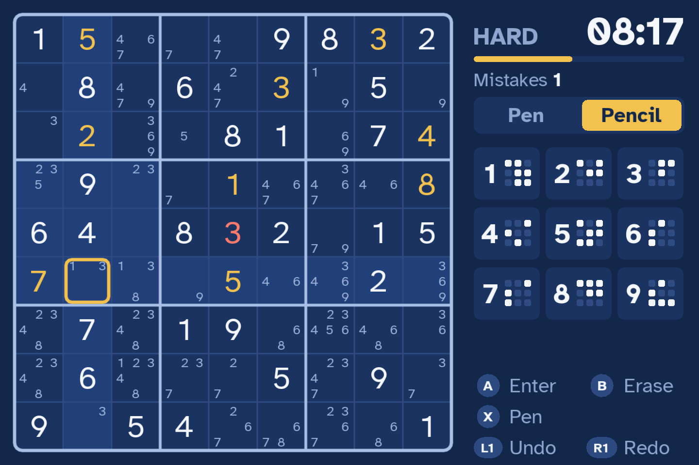
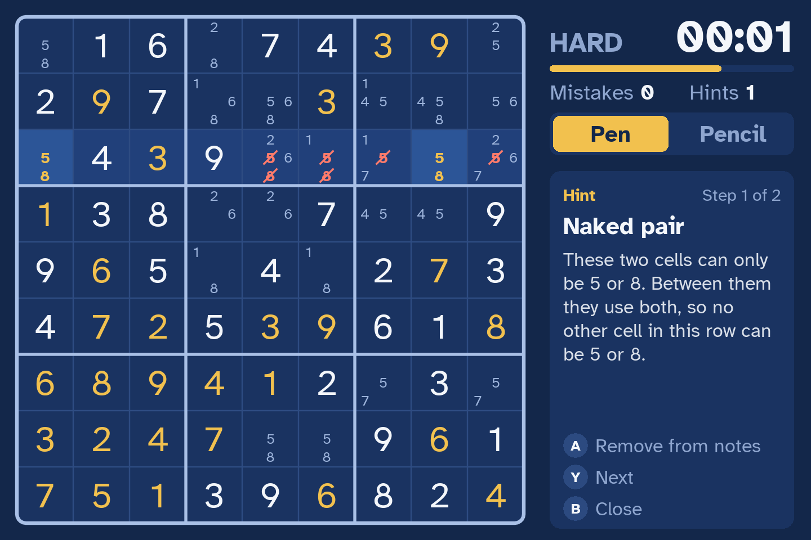 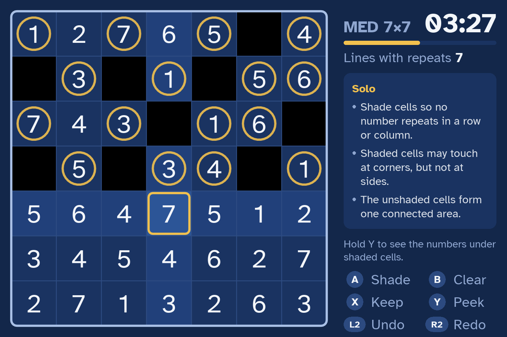
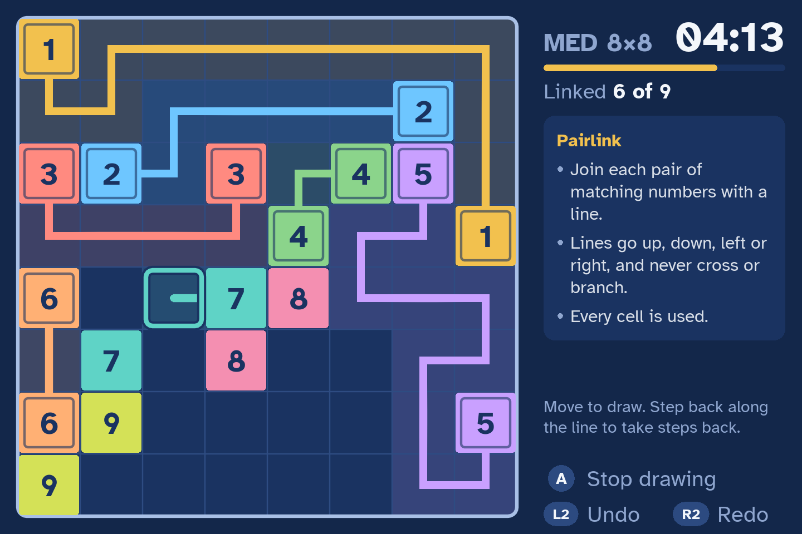 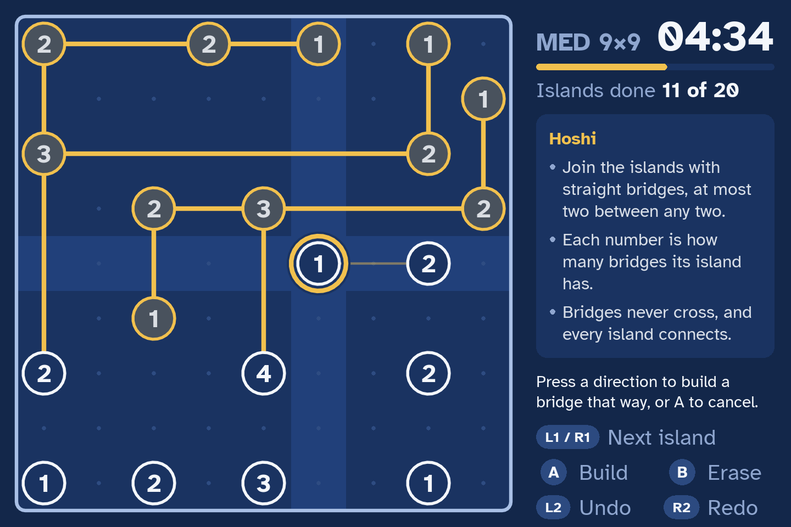

| Game | The goal | Boards | Levels |
|---|---|---|---|
| [Sudoku](#sudoku) | Fill the grid so every row, column and 3×3 box has the numbers 1 to 9 | 9×9 | Easy, Medium, Hard, Expert, Master, plus a daily puzzle and puzzle packs |
| [Solo](#solo) | Shade cells until no number repeats in a row or column | 5×5, 7×7, 9×9 | Easy, Medium, Hard |
| [Pairlink](#pairlink) | Join each pair of matching numbers with a line, filling the board | 7×7, 8×8, 9×9 | Easy, Medium, Hard |
| [Hoshi](#hoshi) | Join numbered islands with bridges, so each has its number of them and all connect | 7×7, 9×9 | Easy, Medium, Hard |

## In every game

- Puzzles are made on the device, always have exactly one solution, and are graded
  by the reasoning a person needs to solve them (see "How puzzles are made" below)
- Each game keeps its own puzzle in progress, saved automatically: **Continue** on the
  title screen picks it up, and starting a puzzle in one game never replaces another
  game's
- Undo and redo, and a pause menu to restart, start a new puzzle or change settings
- Statistics for each game: solved, best and average times, and streaks (Sudoku per
  difficulty, the others per size and level). The Recent page lists the last 50 solves
  across all four games
- Celebrations: solving a puzzle sends a wave across the board, with confetti
- Nine themes. Light: Paper, Sakura, Frankfurt (Lufthansa blue and yellow) and
  Solarized Light. Dark: Cyanotype (default), Solarized Dark, Nord, Gruvbox, and
  Chalkboard (green slate with chalk dust and a wooden frame around the board)
- Sound effects generated in code, so no audio files are needed
- Battery friendly: the screen is only redrawn when something changes, and with
  sound effects off the audio system isn't started at all (see "Idle rendering"
  below)

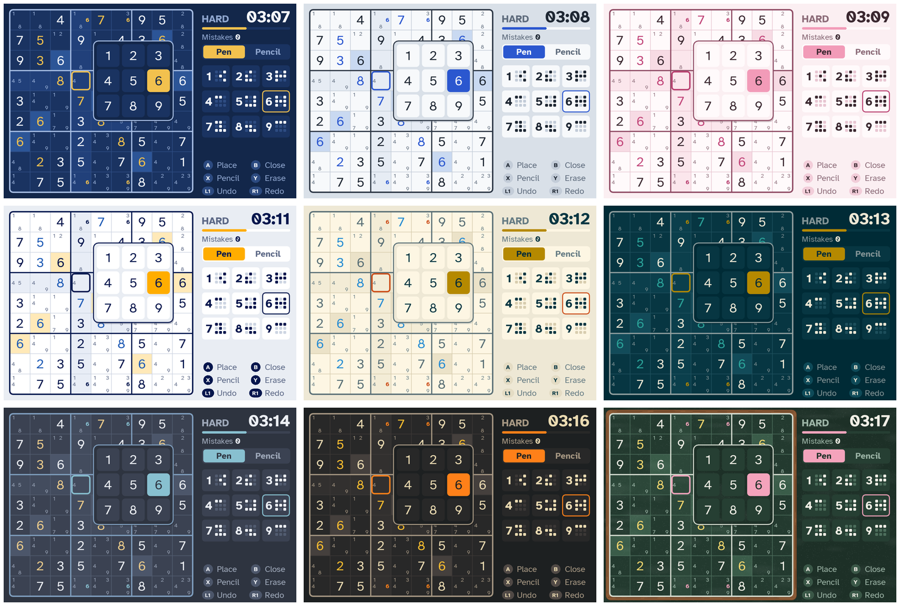

## Install on MustardOS

1. Run `./build.sh`, or use a prebuilt `muSudoku_vX.Y.muxapp`.
2. Copy the `.muxapp` to `/mnt/mmc/MUOS/ARCHIVE/` on the SD card.
3. On the device, open **Applications → Archive Manager** and install it.
4. Launch **muSudoku** from Applications.

Saves (each game's puzzle in progress and statistics) are stored in
`MUOS/application/muSudoku/.game/save/` and puzzle packs in
`MUOS/application/muSudoku/packs/`. Installing an update over the app should keep both,
since the package doesn't contain those files, but back them up before reinstalling.
If the game doesn't start, check `MUOS/application/muSudoku/.game/musudoku.log`.

The power button puts the device to sleep during a game, and the puzzle timer doesn't
count the time asleep. Idle sleep follows the system's power settings, as in other apps.

## Install with PortMaster

Run `./build.sh portmaster`, or download `musudoku.zip` from a release. Copy it to
`PortMaster/autoinstall/` on the SD card, then open PortMaster. It uses the LÖVE 11.5
runtime that PortMaster already includes.

## Controls in every game

| Button | What it does |
|---|---|
| L1 / R1 on the title screen | Pick a game: Sudoku, Solo, Pairlink or Hoshi |
| Left on the title screen | Move to the game boxes: the D-pad picks one, A (or right from the right-hand boxes) goes back to the menu |
| Start / Menu | Pause menu |
| Menu + Start | Save and quit |

Each game's own buttons are in its section below. These are the default shoulder
buttons. **Settings → Shoulder buttons → L1 / R1 undo** swaps the two pairs in every
game, as before version 1.3.3: L1 / R1 then undo and redo (and turn pages and step
through hints), and L2 / R2 do what L1 / R1 did. The on-screen button hints follow the
setting.

On a PC keyboard: arrows move, Enter/Space is A, Backspace is B, X and Y are X and Y,
Q/E are L1/R1, Page Up/Page Down are L2/R2, Tab is Select, Esc is Start, and in Sudoku
1–9 / 0 enter or erase directly.

## Sudoku

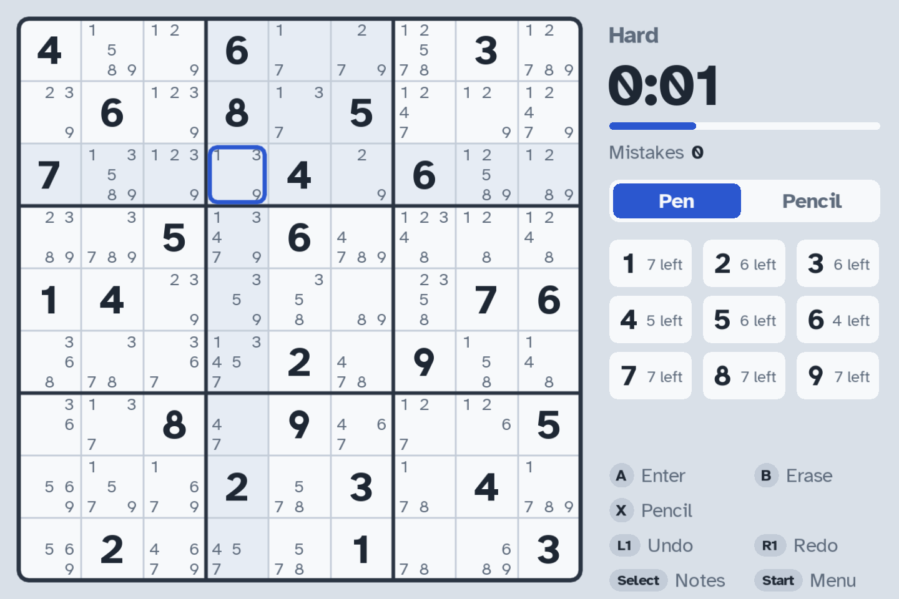 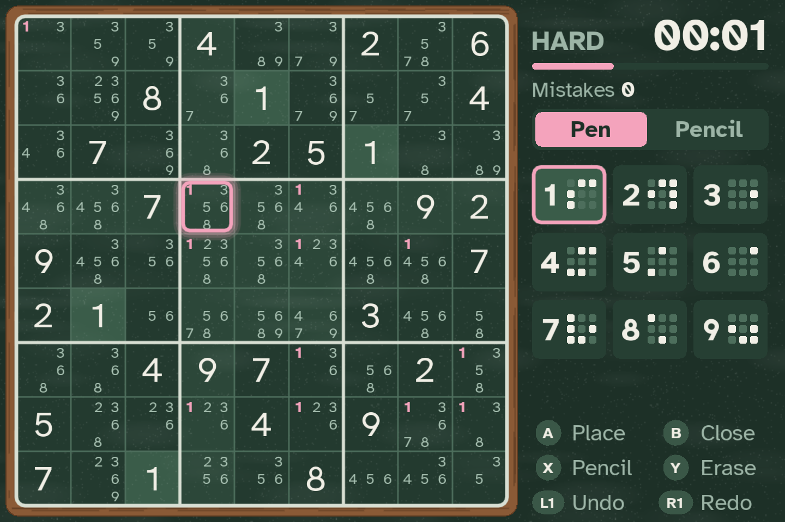

Fill the 9×9 grid so every row, column and 3×3 box holds the numbers 1 to 9.

### Features

- Five difficulties, graded by the techniques a person needs. Two generators to
  choose from in Settings: Classic and Dancing Links (see "How puzzles are made"
  below):
  - **Easy**: scanning rows and boxes (hidden singles)
  - **Medium**: adds cells with only one possible number (naked singles)
  - **Hard**: needs pointing pairs, or naked and hidden pairs and triples
  - **Expert**: needs an X-Wing, Swordfish or XY-Wing
  - **Master**: needs techniques beyond those, such as chains
- Pen and pencil modes, one-button note filling, notes that clear themselves, and a
  Large notes setting for easier reading
- Two ways to enter numbers (Settings → Input): **Cell first** picks a cell, then its
  number from the side panel's number tiles or a pop-up pad (Settings → Number pad).
  **Number first** picks a number with L1 / R1, then A puts it in
  each cell you choose (see "Number-first input" below)
- Optional mistake checking. With it off, **Check board** in the pause menu says how
  many of your numbers are wrong, but not which, for the cost of a hint
- L1 / R1 jump to the previous / next empty cell
- Optional explained hints (off by default): Y finds the easiest logical move and
  explains it on the board, walking through any groundwork it needs first (see
  "Explained hints" below)
- Highlights for the cursor's row, column and box, and for matching numbers
- Distraction-free mode, from the pause menu: just the board, centered on the screen
- Completing a row, column, box or all nine of a number makes the digits bounce in a
  ripple with a glow pulse
- Statistics per difficulty: started, solved, perfect (no hints, no mistakes), best
  and average time. A Streaks page shows puzzles solved in a row per difficulty
  (starting a new one before finishing the current one ends it) and the daily streak
- Daily puzzle: one puzzle a day, the same for everyone, with a streak for days solved
  in a row (see "Daily puzzle" below)
- Puzzle packs: play collections of puzzles published by others, with progress, best
  and average time tracked per pack

### Controls

| Button | On the board | In the number pad |
|---|---|---|
| D-pad | Move (hold to repeat, wraps at edges) | Choose a number |
| A | Open the number pad (Number first: place the chosen number) | Place number, or toggle note in pencil mode |
| B | Erase the cell | Close |
| X | Switch pen / pencil | Switch pen / pencil |
| Y | Hint, if turned on in Settings | Erase the cell |
| L1 / R1 | Previous / next empty cell, hold to repeat (Number first: change the number) | Same, and the pad stays open |
| L2 / R2 | Undo / redo | Undo / redo |
| Select | Fill all notes, or clear them if there are any | |
| Start / Menu | Pause menu | Pause menu |

**Settings → Number pad** sets where you pick the number. With **Side panel** (the
default), the pad is the panel's nine number tiles: A starts picking there, and the
chosen tile is tinted and outlined. Meanwhile the cursor on the board glows softly,
to show the cell is waiting for its number. **Pop-up** opens a 3x3 pad next to the cell.
Distraction-free mode has no side panel, so it always uses the pop-up.

In pen mode the pad closes after placing a number. In pencil mode it stays open so
you can toggle several notes.

### Daily puzzle

**Daily puzzle** on the title screen gives one puzzle per day. It's built from the
date, so everyone playing the same version gets the same puzzle that day, with no
internet needed. It's Easy on Monday, Medium on Tuesday and Wednesday, Hard on Thursday
and Friday, and Expert at the weekend.

The title screen shows whether today's puzzle is solved and your streak of days solved
in a row. A day counts whenever its puzzle is solved, so finishing yesterday's puzzle
after midnight still keeps the streak. Daily puzzles don't count toward the
per-difficulty statistics. The puzzle depends on the device's date, so if the clock
was never set, the game asks you to set it in the system settings first.

### Puzzle packs

Puzzle packs are text files of puzzles you add yourself. Put them in:

```
MUOS/application/muSudoku/packs/
```

That's the folder next to `mux_launch.sh` on whichever SD card the app is installed
on. It's created on first launch, and the game shows the exact path if it's empty.
Open **Puzzle packs** from the title screen, pick a file, then play the next unsolved
puzzle, a random one, or a puzzle by number.

**Formats.** Files ending in `.txt`, `.sdm`, `.sdk`, `.csv` or `.ss` are read. Each
puzzle is either one line of 81 characters (1–9 for givens, 0 or . for empty cells)
or a grid of 9 lines with 9 cells each. Divider lines, `|`, header lines like
`Grid 01`, `#` comments and extra columns (ids, ratings, CSV fields, a solution after
the puzzle) are ignored. Up to 100,000 puzzles per file are used, so split bigger
collections into several files.

**Checking and grading.** When you start a puzzle the game checks it has exactly one
solution, skipping it with a message if not, and grades it Easy to Master with the
same rules as generated puzzles. Pack puzzles don't count toward the per-difficulty
statistics. Instead each pack keeps its own best time (solves without hints), average
and perfect solves, shown on its screen. Progress is saved per file name, and
changing a file's contents resets its progress.

**Where to find puzzles.** The Sudoku Exchange puzzle bank
(github.com/grantm/sudoku-exchange-puzzle-bank) says its puzzles are free to use for
any purpose. Other well-known collections, such as Gordon Royle's 17-clue list, the
Enjoy Sudoku forum's hardest puzzles and Kaggle datasets, have their own terms or none
stated, so check before sharing them further.

The muxapp ships `Starter pack.txt`: 40 puzzles from this game's own generator, free
to use.

### Explained hints

Hints are off by default. Turn them on in **Settings → Hints**, which has three
choices: **Off** hides the hint button and the hint counter, **Explained** gives the
hints described here, and **Instant** reveals a number straight away.

With Explained hints on, press Y and the side panel explains the easiest move a
person could make right now, with the board highlighting the cells involved:

- **Only place for a number:** a number that fits just one cell in a row, column or
  box. The numbers blocking the other cells are circled.
- **Only number that fits:** a cell where every other number is already in its row,
  column or box.
- **Last empty cell** in a row, column or box.
- **Groundwork steps** for harder puzzles: pointing pairs, numbers locked in a box,
  naked pairs and triples, hidden pairs, and for Expert puzzles X-Wings, Swordfish
  and XY-Wings. Ruled-out candidates are struck through in red, and A removes them
  from your notes. Only steps the final move depends on are shown.
- **Mistakes come first:** if a number on the board is wrong, the hint points it out
  and A erases it.
- **Fallback:** for moves beyond these techniques (Master puzzles), it says so and
  offers the number. Every puzzle up to Expert can be solved with explained hints
  alone.

In the hint: A does the step's action, Y goes to the next step, L2 goes back, B
closes. Opening a hint counts as one hint. Hints work from the numbers on the board, not your notes, so
they're right even when your notes are incomplete.

Instant hints reveal the selected cell, or the easiest unsolved cell if the selected
one is already right. Hinted cells lock, and solves with hints don't count toward best
times.

### Number-first input

With **Settings → Input → Number first**, there's no pad. L1 / R1 choose a number,
which is highlighted in the side panel and on the board, and A puts it in the cell
under the cursor, or toggles it as a note in pencil mode. A on a cell that already
has that number clears it. A on a given picks up the given's number instead. L1 / R1
skip numbers that are already on the board nine times, and once the chosen number
is placed nine times, the next number still needed is chosen. An empty cell shows a
faint preview of what A would put there.

### Distraction-free mode

Choose **Distraction-free** in the pause menu to hide the side panel and center the
board, with nothing else on screen. **Show side panel** in the same menu brings it
back, and the choice is remembered. The clock keeps running and shows in the pause
menu, and an explained hint brings the panel back until you close it.

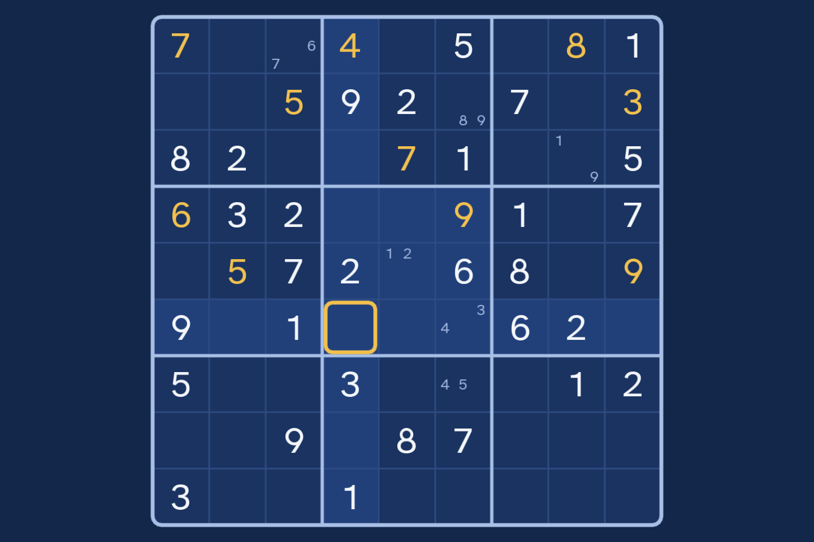

## Solo

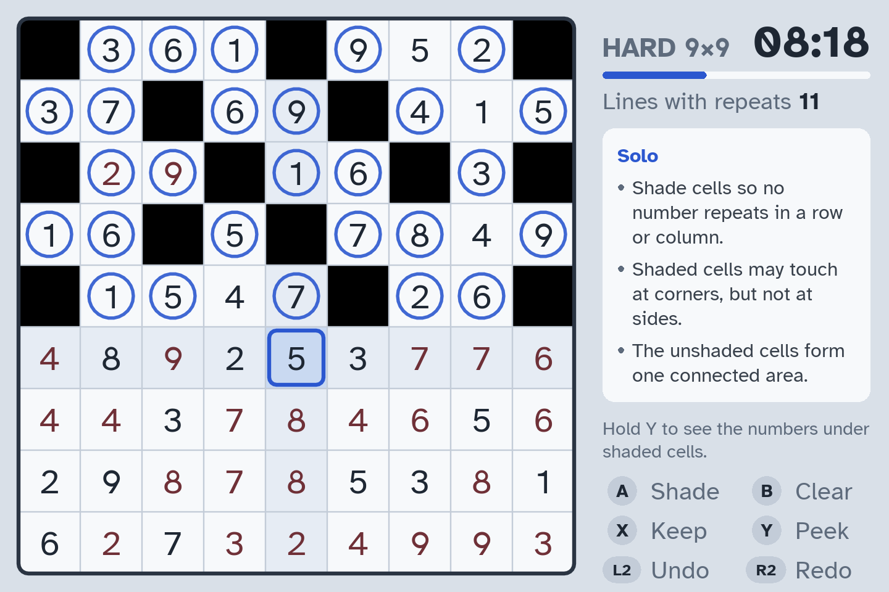

Solo is a Hitori-style puzzle. The board is full of numbers, and some repeat. Shade
cells until:

- no number appears twice, unshaded, in a row or column
- shaded cells touch only at corners, never side by side
- the unshaded cells form one area, connected side by side

As usual for this kind of puzzle, a cell is only shaded to remove a repeat, which is
what gives each puzzle a single solution. Any shading that keeps the rules counts as
solved.

| Button | Solo |
|---|---|
| D-pad | Move (hold to repeat, wraps at edges) |
| A | Shade the cell, or unshade it |
| X | Mark the cell to keep (a ring), or remove the mark |
| B | Clear the cell |
| Y (hold) | Show the numbers under shaded cells |
| L2 / R2 | Undo / redo |
| Start / Menu | Pause menu |

Shaded cells turn black and hide their number; hold Y to see them while it's held.
A number that still repeats in its row or column is tinted a soft red, and goes back
to normal once its repeats are shaded (turn this off in **Settings → Show repeats in
Solo**). The side panel counts the rows and columns that
still have a repeat. With Highlight
matching numbers on, the cursor's row and column light up, with its number's repeats
picked out.

**Sizes and levels.** 5×5, 7×7 and 9×9 (one digit per cell), each in three levels,
graded by the reasoning a person needs:

- **Easy**: numbers without repeats stay; cells beside a shaded cell stay; a kept
  number's repeats are shaded; in x y x the y stays; next to an x x pair, other x's in
  that line are shaded
- **Medium**: adds connection: a cell whose shading would cut the unshaded area in two
  stays
- **Hard**: needs trying a cell one way and finding that it breaks a rule

## Pairlink

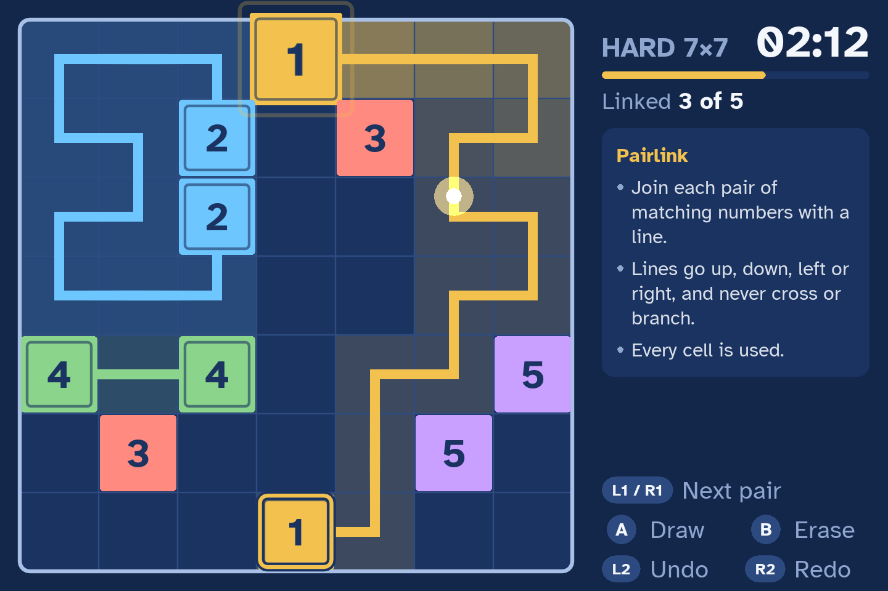

Pairlink is a Numberlink-style puzzle. Join each pair of matching numbers with a line:

- lines go up, down, left or right from cell to cell
- they never cross, branch or pass through another number
- together they use every cell

| Button | Pairlink |
|---|---|
| D-pad | Move the cursor; while drawing, draw the line (step back along it to take steps back) |
| A | Start drawing from a number, or from a cell of a line (the line is cut back there); A again stops |
| B | Erase the line under the cursor (or stop drawing) |
| L1 / R1 | Jump to the previous / next pair that isn't linked yet |
| L2 / R2 | Undo / redo (a whole line drawn, or erased, at a time) |
| Start / Menu | Pause menu |

Starting from a number replaces that pair's line. Reaching the other number links the
pair: a bright bead runs along the line, its cells flash in turn, both numbers pop with
a ring, and a chime plays. Breaking a linked line, with B or by drawing from it again,
snaps it: sparks fly from the break, the loose pieces spring back into their numbers,
and it cracks. Cells a line uses are tinted with its colour, and the side panel shows
how many pairs are linked and how much of the board is used.

**Sizes and levels.** 7×7, 8×8 and 9×9, each with at most 9 pairs (one digit per
number), in three levels:

- **Easy**: lines with only one way to go (a number has one way out and any other cell
  two, so a cell with only that many ways left uses them all; no loops, and no line
  joins two different pairs)
- **Medium**: adds reach: a cell only one pair's line can still reach belongs to that
  pair, and cells side by side that no pair can reach both of aren't linked
- **Hard**: needs trying a line's next step and finding that it breaks a rule

## Hoshi

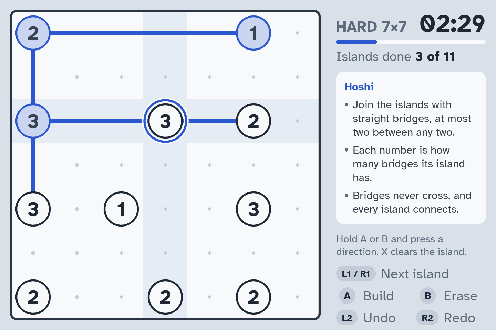

Hoshi is a Hashiwokakero-style puzzle. The board is water with numbered islands. Join
the islands with bridges:

- bridges run straight along a row or column, between two islands with only water
  between them
- two islands have at most two bridges between them
- an island's number is how many bridges end at it
- bridges never cross, and together they connect every island

| Button | Hoshi |
|---|---|
| D-pad | Move to the next island that way (the next one in line, or else the nearest one that way); while drawing, draw a bridge that way |
| A | Start drawing from the island; A again stops |
| B | Take away the island's bridges (or stop drawing) |
| L1 / R1 | Jump to the previous / next island that doesn't have its number of bridges |
| L2 / R2 | Undo / redo |
| Start / Menu | Pause menu |

Bridges are drawn like Pairlink's lines. While drawing, each direction draws a bridge to
the island that way, and the cursor goes on to that island, so one bridge can follow
another. Drawing over a bridge makes it two, so for two bridges go across and back again;
drawing over two takes them away (next to a 1, drawing over one does). Faint lines show
where a bridge can still go. A bridge that would cross another isn't built, and the one in its way
glows red. An island with its number of bridges is tinted in the bridges' colour, and
one with too many turns red. The cursor's row and column are lit, so islands in line
with it stand out, and the side panel counts the islands done.

**Sizes and levels.** 7×7 and 9×9 (about 12 and 20 islands), each in three levels:

- **Easy**: counting: an island needs its number of bridges, so if its other links
  can't make up the rest, a link must have some, and if they already have most of them,
  a link can't have more. A bridge rules out the links it would cross
- **Medium**: adds connecting: a bridge that would close off a group of islands that
  can't take any more bridges is ruled out (a 1 to a 1, or a double bridge from a 2 to
  a 2, while other islands are waiting), and a group with only one way out must take it
- **Hard**: needs trying a link's lowest or highest number of bridges and finding that
  it breaks a rule

## How puzzles are made

Every puzzle, in every game, has only one solution, so it can always be worked out,
and there's never a point where two different answers would both be right.

### Sudoku

1. The game fills a complete 9×9 grid at random. That grid is the answer.
2. It removes clues in mirror-image pairs, which keeps the puzzle symmetric. After
   each pair, the solver checks whether the puzzle could now be completed in any way
   other than the answer. If it could, the pair goes back. So no clue is ever removed
   unless the answer stays the only solution.
3. The puzzle is graded by the techniques it needs (see Sudoku's features). If it's
   too easy for the chosen difficulty, more clues come out, each pair checked the same
   way. If it's too hard, removed pairs go back one at a time until it isn't. More
   clues can never allow a second solution. Each difficulty gets several tries, and if
   none matches exactly, the closest one is used. It too has only one solution.

   Fully dug-out puzzles mostly need either very little or a lot: only about 1 in 40
   needs exactly an X-Wing, Swordfish or XY-Wing. Putting pairs back is what lets
   Expert puzzles come out at that level reliably.

**Two generators.** Settings → Puzzle generator picks the solver used in steps 1 and
2. Both follow the steps above, so the puzzles are equally unique and graded the same
way:

- **Classic** (default): a backtracking solver that fills the most constrained cell
  first.
- **Dancing Links**: Donald Knuth's Algorithm X with dancing links. Sudoku becomes an
  exact cover problem: 729 choices (a digit in a cell) and 324 rules that must each be
  met exactly once (every cell filled, every digit once per row, column and box). It
  takes a little longer than Classic.

The daily puzzle always uses Classic, with a random number generator seeded from the
date that gives the same numbers on every device (`src/daily.lua`).

Pack puzzles weren't made by this generator, so the game checks each one for a single
solution when you start it (see "Puzzle packs").

### Solo, Pairlink and Hoshi

Solo, Pairlink and Hoshi (`src/solo.lua`, `src/pairlink.lua`, `src/hoshi.lua`) are built
the other way round:
from a solution. Each has a solver that only uses the reasoning listed for its levels,
and every step it takes is sound, so when it solves a puzzle completely, that solution
is the only one. A puzzle is only offered once that solver has finished it, so every
puzzle has a solution, and just one.

- **Solo** makes a random Latin square (each number once per row and column), shades
  random cells that don't touch and keep the rest connected, and gives each shaded
  cell the number of an unshaded cell in its row or column. It tries again until the
  solver finishes it at the chosen level.
- **Pairlink** covers the board with many short random lines, whose ends become the
  numbers, and cuts a line in two wherever the solver gets stuck. Then, the way a
  Sudoku is dug out, it joins neighbouring lines (one pair fewer each time) and moves
  line ends around, keeping each change only while the solver can still finish the
  puzzle at the chosen level. A puzzle still left with more than 9 pairs gets a few
  more rounds, and is dropped if that isn't enough.
- **Hoshi** builds the answer first: one island, then island after island, each placed
  across the water from one already there and joined to it by one or two bridges, never
  over a bridge or right beside another island. Extra bridges then join some islands
  that already see each other, which makes loops. Each island's number is its count of
  bridges, so the answer always fits. Double bridges give a lot away, so Easy puzzles
  get many and the others few. About half the answers come out Easy and over half
  Medium, but only a few in a hundred need Hard's trying, so Hard goes through more
  answers before one fits (up to 400; on a PC that's still well under a second).

### Tests

`./build.sh test` generates puzzles of every game, at every level and size, and checks
that each has exactly one solution. Sudoku puzzles are made with both generators, using
the other solver to confirm Dancing Links puzzles. Solo, Pairlink and Hoshi solutions
are checked against the rules, and the smaller boards (Solo 5×5 and 7×7, Pairlink 7×7)
and every Hoshi board are also counted by brute force, independently of the solver.

## Development

Requirements: LÖVE 11.5 and LuaJIT for running on a PC, plus `bash`, `git` and `zip`
for building.

```sh
./build.sh run            # play on a PC (720x480 window)
./build.sh run 640x480    # try another resolution
./build.sh test           # engine, puzzle pack, hint, Solo, Pairlink and Hoshi tests (luajit)
./build.sh love           # build/muSudoku.love
./build.sh                # build/muSudoku_vX.Y.muxapp
./build.sh portmaster     # build/portmaster/musudoku/ and build/musudoku.zip
```

### On macOS

1. Download LÖVE 11.5 for macOS from https://love2d.org and drag `love.app` into
   Applications. If macOS blocks it the first time, right-click it and choose Open.
2. In Terminal, from this folder: `./build.sh run` (it finds `love.app` itself). Puzzle
   packs are read from the project's `packs/` folder.
3. Optional: `brew install luajit` for `./build.sh test`.

Saves go to `~/Library/Application Support/LOVE/musudoku/`. Delete that folder to
start fresh. `./build.sh` also builds the `.muxapp` on a Mac (needs `git`, which comes
with the Xcode command line tools).

### Screenshot harness

`MUSUDOKU_AUTOSHOT=1 love game` plays through every screen automatically and saves
screenshots to the LÖVE save folder (`~/.local/share/love/musudoku/shots/` on
Linux). Use it to check layout changes. With no display, prefix it with
`xvfb-run -a` and set `SDL_AUDIODRIVER=dummy`.

### Idle rendering

`main.lua` replaces LÖVE's default loop, which redraws 60 times a second, with one
that draws only when needed:

- after any button press, plus 0.1 s to be safe
- while the top screen's `busy()` returns true (cursor sliding, the pad and menus
  opening, flashes, the win wave, puzzle generation, reading a pack)
- when a screen calls `app.requestRedraw()`, which the timer does once a second

In between it sleeps, checking for input 60 times a second, or 30 once nothing has
been pressed for 2 seconds. Analog-stick drift doesn't wake it. Every animation
relies on `busy()`: when adding one, make the screen's `busy()` return true while it
runs, or it will freeze mid-way.

The audio mixer runs all the time once started, even when silent, so `conf.lua`
reads the saved settings first and leaves the audio modules out when sound effects
are off. Turning sound on later loads them then.

`MUSUDOKU_FXSHOTS=1 love game` captures the completion effects mid-animation.

`MUSUDOKU_GAMESHOTS=1 love game` plays through the Solo, Pairlink and Hoshi screens
(the title's game boxes, new puzzle, play, a link effect, drawing bridges, pause, wins
and statistics, in several themes) and saves screenshots named `g*.png`.
`MUSUDOKU_GAMESHOTS=hoshi` takes only Hoshi's.

`MUSUDOKU_IDLETEST=1 love game` measures it. On a PC, a puzzle left alone for 10 seconds
drew 10 frames (one per timer tick) instead of about 600, and none with the timer
hidden. A button press draws about 7 frames.

### Project layout

```
mux_launch.sh        MustardOS launcher (sets up SDL, saves, runs LÖVE)
mux_lang.ini         Name and help text shown in the MustardOS menu
glyph/               Menu icon
portmaster/          PortMaster launcher, port.json, gameinfo.xml, README and
                     screenshot
screenshots/         Images used in this README (not packaged)
build.sh             Build, test and run commands
packs/               Starter pack (copied into the muxapp)
tests/               Engine, pack-format, Solo, Pairlink and Hoshi tests (plain luajit,
                     no LÖVE needed)
game/                The LÖVE game (becomes .game/ in the muxapp)
  main.lua           Scene stack, saving, resolution handling
  src/sudoku.lua     Solver, generator and difficulty grader
  src/dlx.lua        Dancing Links (Algorithm X) solver, the other generator option
  src/game.lua       Puzzle state, notes, undo/redo, hints, serialization
  src/storage.lua    Settings, statistics and save files
  src/packs.lua      Puzzle pack folder, file formats, indexing, progress
  src/daily.lua      Daily puzzle dates, seeds and streaks
  src/history.lua    Recent solves for the Statistics page
  src/records.lua    Per-difficulty counts, best times and streaks
  src/hints.lua      Explained hints: finds moves and writes explanations
  src/solo.lua       Solo solver, generator and grader
  src/sologame.lua   Solo puzzle in progress: marks, undo/redo, saving
  src/pairlink.lua   Pairlink solver, generator and grader
  src/pairgame.lua   Pairlink puzzle in progress: lines, undo/redo, saving
  src/hoshi.lua      Hoshi solver, generator and grader
  src/hoshigame.lua  Hoshi puzzle in progress: bridges, undo/redo, saving
  src/boardscene.lua What the Solo, Pairlink and Hoshi play screens share
  src/ui.lua         720x480 layout scaling, text and button glyphs
  src/input.lua      Gamepad and keyboard mapping, hold-to-repeat
  src/theme.lua      Color themes, chalk dust texture, wooden frame, Solo's
                     shading and Pairlink's line colours
  src/sound.lua      Synthesized sound effects
  src/scenes/        Title, difficulty, generating, play, pause, win,
                     settings, statistics, confirm, packs, pack and about
                     screens, and for Solo, Pairlink and Hoshi: choose (size
                     and level), soloplay, pairplay and hoshiplay
  dev/autoshot.lua   Screenshot harness (left out of builds)
  dev/gameshots.lua  Screenshot harness for Solo, Pairlink and Hoshi (left out of
                     builds)
  dev/idletest.lua   Measures frames drawn while idle (left out of builds)
  dev/fxshots.lua    Screenshots of the completion effects (left out of builds)
  dev/hintshots.lua  Screenshots of explained hints (left out of builds)
```

### The LÖVE runtime

MustardOS doesn't include LÖVE, so the muxapp bundles an aarch64 build of LÖVE 11.5
(`bin/love` and `bin/libs.aarch64/`). `build.sh` downloads a prebuilt runtime by
saitamasahil (MIT licensed) at a pinned tag, because it's known to work on MustardOS H700
devices. To use a different
runtime, set `LOVE_RUNTIME=/path/to/dir` containing `love` and `libs.aarch64/`.
That bundle includes libraries the game doesn't need, so a trimmed runtime would
make the package much smaller.

## Credits and licenses

muSudoku was created by amiralul. **About** on the title screen shows these credits
in the game.

- Game code: MIT (see `LICENSE`)
- Atkinson Hyperlegible font by the Braille Institute: SIL Open Font License
- LÖVE: zlib license
- MustardOS package's aarch64 LÖVE runtime and launcher structure: saitamasahil (MIT)
- Dancing Links generator: Donald Knuth's Algorithm X
- Theme colors: Solarized by Ethan Schoonover, Nord by Arctic Ice Studio and Gruvbox
  by Pavel Pertsev (all MIT)
